

  

  <b>See and manage all UniFi clients and DHCP reservations in one table — right inside Home Assistant.</b> 
  MAC · name · fixed IP · VLAN · WiFi / wired / Teleport · issues · versions · bulk changes

  

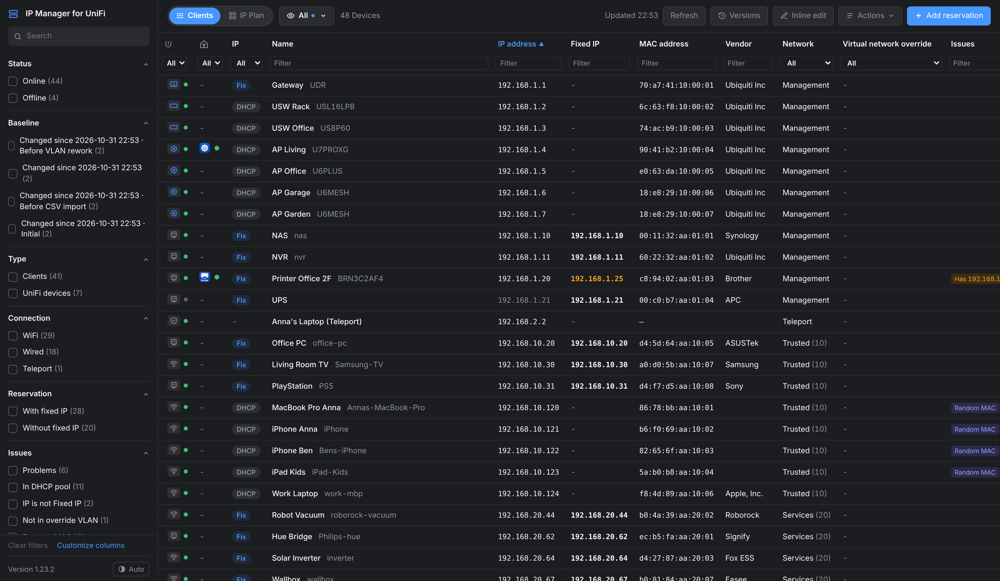

UniFi Network spreads DHCP reservations over individual client pages, and there is no single place to check which device has
which fixed IP in which VLAN. **IP Manager for UniFi** is a Home Assistant add-on that gives you exactly that view. It is styled like
UniFi Network, and it adds bulk tools that UniFi doesn't have: subnet migration, CSV import, names from Home Assistant, and
versions you can compare and restore.

▶️ **[Watch the 1¾-minute demo video](docs/promo.mp4)**

## Features

| | |
|---|---|
| **One table for everything** | Every client and UniFi device (APs, switches, gateway) with MAC, name, fixed IP, network/VLAN, connection type (WiFi, wired with switch port, Teleport), locked AP, first and last seen. Sort and filter every column. Reorder columns by drag & drop. |
| **Issue hints** | Duplicate IP, fixed IP outside its network, fixed IP inside the DHCP pool, device currently using a different IP, random/private MAC, device not on its locked AP, VLAN override. |
| **Edit** | Name, note, fixed IP + network, lock to an access point, local DNS record. Add reservations for MACs the controller has never seen. Remove a reservation or forget the client. |
| **Views** | SharePoint-style views store columns, order, filters and sort. Built-in *All* and *DHCP Reservations*. Views are shared by every browser. |
| **Inline edit** | Edit names and fixed IPs directly in the table (Enter / ↑ / ↓ move to the next row). |
| **Replace subnet** | Move all fixed IPs from e.g. `192.168.30.x` to `192.168.31.x`, keeping the host part. A preview catches collisions before anything changes. |
| **Names from Home Assistant** | Proposes the names from the HA device registry, matched by MAC. Includes a "near match" for devices with separate WiFi/Ethernet MACs. |
| **Versions** | Snapshot the table manually, daily, and automatically before every bulk action. **Compare** two versions (new / removed / changed devices; spots a device that came back with a new random MAC). **Restore** through a preview. A *Changed since …* filter shows what changed since a version, and each device has a **history** timeline: which change, in which version. |
| **CSV import & export** | Bulk changes with a validated preview and a checkbox per row. An export can be re-imported as is. |
| **Reconnect** | After a fixed IP change, online Wi-Fi clients can be reconnected right away so they pick up the new address – per device or for a whole subnet move. |
| **IP plan** | Utilization per network (fixed / in pool / dynamic / free outside the pool) and an address grid that shows conflicts at a glance. Click a free address to reserve it. |
| **CleanUp Proposal** | Suggests a tidy layout (fixed block + DHCP pool behind it), shows the resulting IP plan and applies the checked measures – moves, reconnect and the pool change (after a second confirmation). |
| **New-device alerts** | A Home Assistant notification and the event `clients_reservations_new_device` when a MAC appears that was never seen before – optionally only for certain networks. |
| **Network rules** | “Vendor contains Espressif → IoT”: devices in the wrong network are flagged. |
| **Ping & port check** | Ping with round-trip times, and an on-demand check of ~30 common TCP ports per device; web UIs become links, Telnet/FTP are flagged. |
| **Housekeeping** | Vendor lookup for unknown MAC prefixes, duplicate names / DNS names, *Inactive* filter (not seen > 30 / 90 / 365 days), hosts-file export, Wake on LAN. |
| **Safe bulk changes** | Every bulk action (CSV import, restore, replace subnet, names from HA) saves a version of the current settings first, so you can always go back via *Versions › Restore*. |

## Screenshots

<table>
  <tr>
    <td colspan="2" valign="top">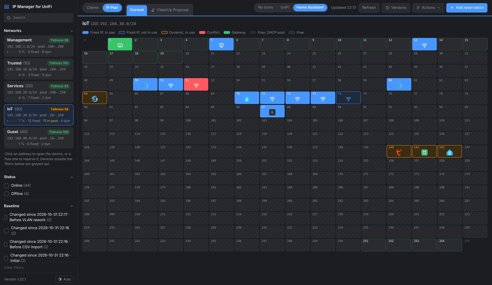 <b>IP plan</b> – utilization per network and an address grid: fixed IPs in use / not in use, dynamic leases, conflicts, DHCP pool and free addresses.</td>
  </tr>
  <tr>
    <td colspan="2" valign="top">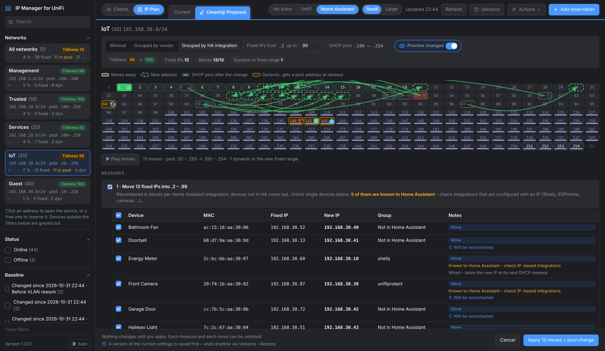 <b>CleanUp Proposal</b> – Current / Proposal / Changes (arrows and animation of every move) and the measures, each with a checkbox.</td>
  </tr>
  <tr>
    <td width="50%" valign="top">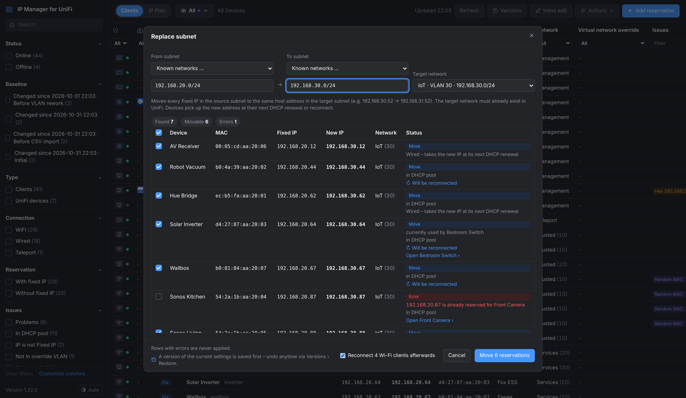 <b>Replace subnet</b> – preview with collision check (an address that is already reserved is an error, an address in use is a warning) and optional reconnect of the affected Wi-Fi clients.</td>
    <td width="50%" valign="top">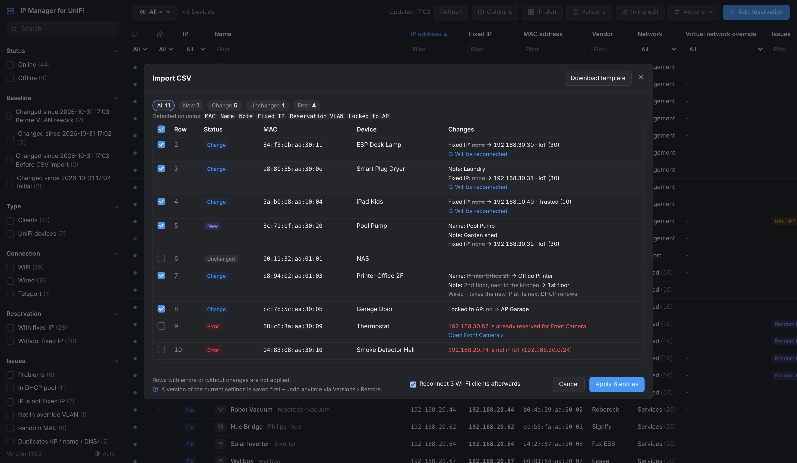 <b>CSV import</b> – every row is validated before anything changes: duplicate IP, IP outside the network, invalid MAC, unknown AP.</td>
  </tr>
  <tr>
    <td valign="top">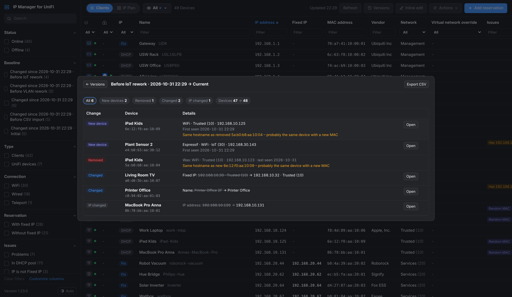 <b>Compare versions</b> – new, removed and changed devices since a snapshot.</td>
    <td valign="top">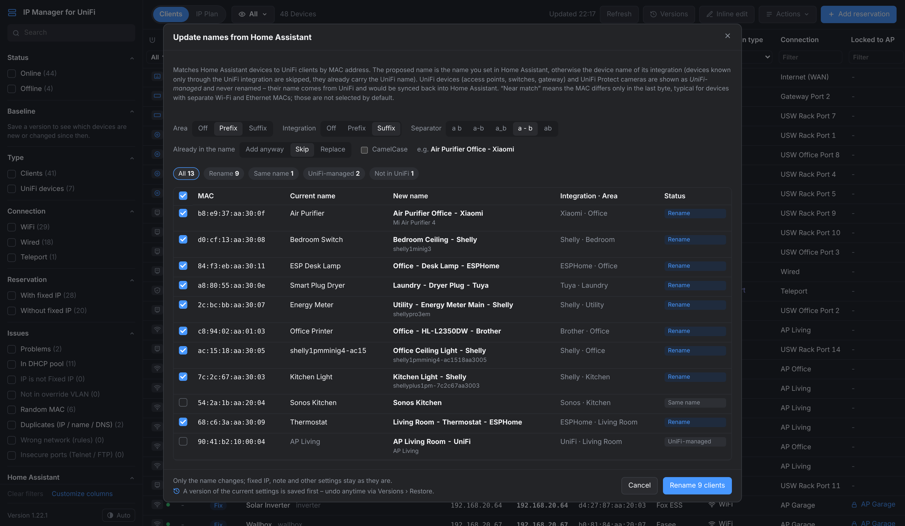 <b>Names from Home Assistant</b> – rename UniFi clients after your HA device names.</td>
  </tr>
  <tr>
    <td valign="top">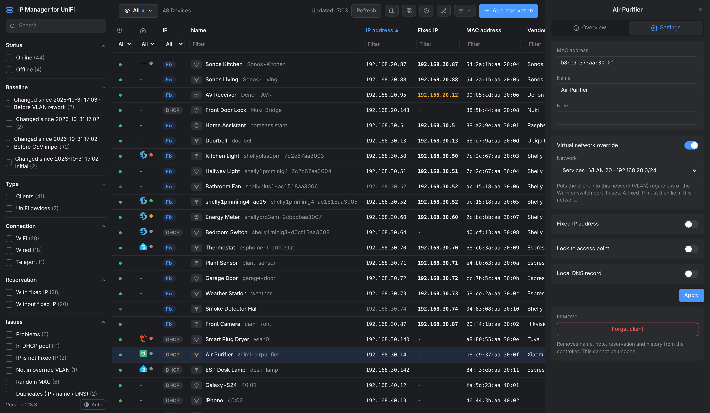 <b>Edit</b> – fixed IP, network, AP lock and local DNS in the detail panel.</td>
    <td valign="top">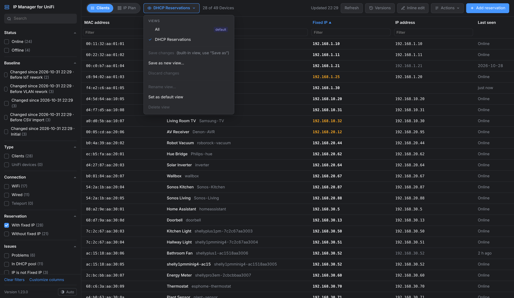 <b>Views</b> – e.g. the built-in <i>DHCP Reservations</i> view.</td>
  </tr>
  <tr>
    <td valign="top">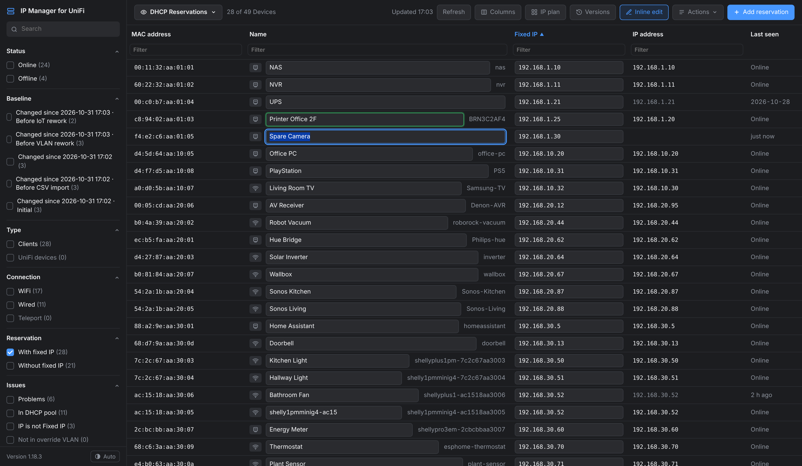 <b>Inline edit</b> – names and fixed IPs right in the table.</td>
    <td valign="top">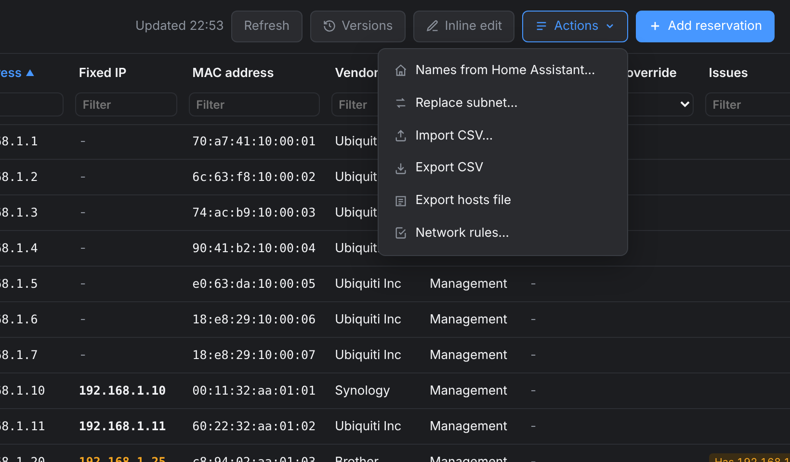 <b>Actions</b> – the bulk tools: names from Home Assistant, replace subnet, CSV import and export.</td>
  </tr>
  <tr>
    <td valign="top">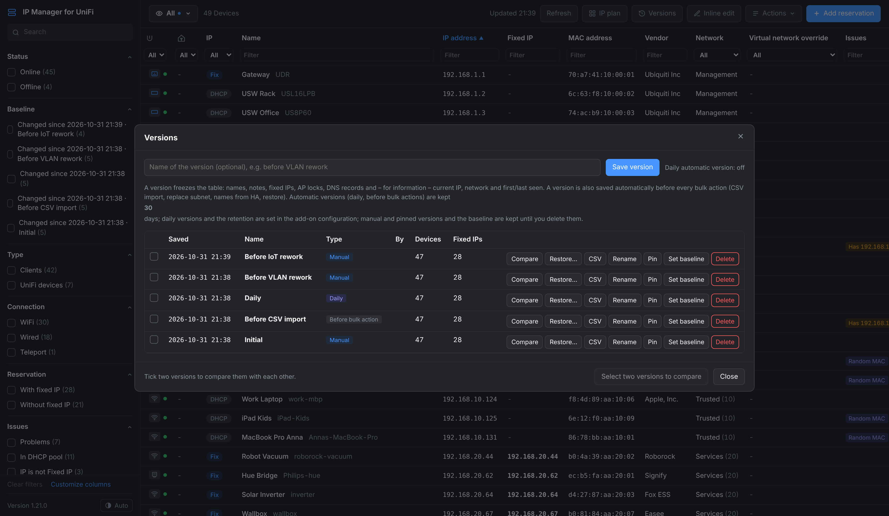 <b>Versions</b> – manual, daily and before-bulk-action snapshots.</td>
    <td valign="top">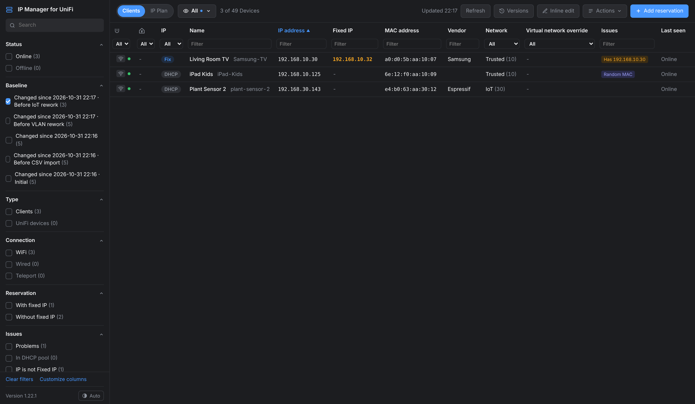 <b>Changed since …</b> – sidebar filter for new or changed devices.</td>
  </tr>
  <tr>
    <td valign="top">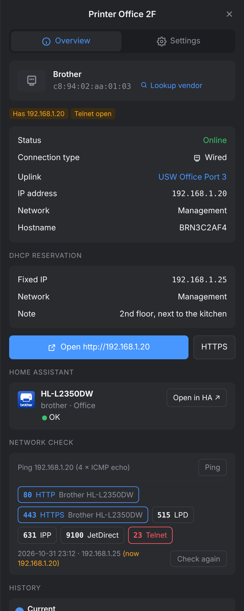 <b>Detail panel</b> – open the device in the browser, and its <b>history</b>: what changed, in which version.</td>
    <td valign="top">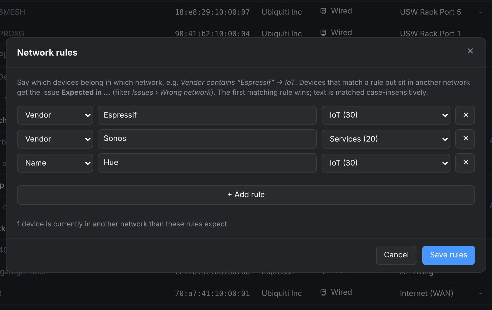 <b>Network rules</b> – which devices belong in which network; violations show up as issues.</td>
  </tr>
  <tr>
    <td valign="top">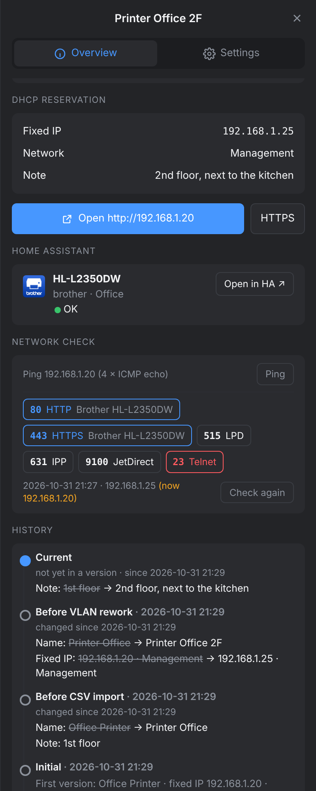 <b>Network check</b> – ping, plus open ports: web UIs as links with their page title; insecure protocols flagged.</td>
    <td valign="top"></td>
  </tr>
</table>

All screenshots and the video use a fictional demo network.

## Requirements

- Home Assistant **OS** or **Supervised** (add-ons are required), on `amd64` or `aarch64`.
- A UniFi OS console running UniFi Network (UDM / UDM Pro / UDR / UCG / UX / Cloud Key Gen2+, or a self-hosted UniFi OS Server).
- A **local** UniFi account (not a Ubiquiti cloud account, no 2FA) with permission to edit clients.

## Installation

1. Click the button above, **or** go to *Settings → Add-ons → Add-on Store → ⋮ → Repositories* and add
   `https://github.com/raphaelkoeppel/ha-unifi-clients-reservations`
2. Install **IP Manager for UniFi**. Home Assistant builds the image locally, so this takes a minute.
3. On the *Configuration* tab, enter the gateway IP, username and password, then start the add-on.
4. Turn on *Show in sidebar* (the panel is called *IP Manager*), or open it via *Open Web UI*.

## Configuration

| Option | Default | Description |
|---|---|---|
| `unifi_host` | `192.168.1.1` | IP or hostname of the UniFi console (without `https://`) |
| `username` / `password` | – | Local UniFi account |
| `site` | `default` | UniFi site name |
| `verify_ssl` | `false` | Keep off while the console uses its self-signed certificate |
| `certificate_fingerprint` | – | Pin the controller certificate (SHA-256); the add-on log shows the value to paste at start |
| `daily_version` | `true` | Save one version of the table per day |
| `auto_version_retention_days` | `30` | Days to keep automatic versions; manual, pinned and baseline versions are kept until deleted |
| `notify_new_devices` | `true` | Notify Home Assistant about devices with a never-seen MAC |
| `notify_networks` | `[]` | Only watch these networks (names or VLAN IDs); empty = all |
| `notify_random_mac` | `false` | Also notify about random/private MACs (phones, tablets) |
| `vendor_lookup` | `true` | Fill unknown vendors via macvendors.com (only the 3-byte prefix is sent, cached) |

**Security notes**

- Create a dedicated local UniFi user for this add-on, with the *Network* admin role (needed to edit clients) and not as owner or super admin.
- The password is stored in the add-on's options inside Home Assistant (masked in the UI). It is never logged and never sent to the browser.
- Home Assistant backups contain add-on options, so keep your backups encrypted.
- The UI is only reachable through Home Assistant Ingress. The add-on does not expose a port.
- Pin the controller certificate with `certificate_fingerprint` – the self-signed UniFi certificate is otherwise not verified.
- Ping, port check and Wake on LAN only work for addresses inside your UniFi networks. CSV exports are protected against formula injection.

Full documentation: [`dhcp_reservations/DOCS.md`](dhcp_reservations/DOCS.md) · Changes: [`CHANGELOG.md`](dhcp_reservations/CHANGELOG.md)

## How it works

A small Python service (standard library only) inside the add-on talks to the UniFi Network API of your console:

- **Read:** `rest/user`, `stat/sta`, `stat/device`, `rest/networkconf`, and v2 `clients/active` for Teleport.
- **Write:** `rest/user` for name, note, fixed IP, AP lock and local DNS, and `cmd/stamgr forget-sta` to forget a client.

For *Names from HA*, the service reads the Home Assistant device registry through the Supervisor API (read-only). Views and versions are stored in the add-on's `/data` folder, so they are included in Home Assistant backups.

## Disclaimer

This is a community project. It is not affiliated with or endorsed by Ubiquiti Inc. or the Home Assistant project.
UniFi is a trademark of Ubiquiti Inc. It uses the controller's unofficial local API, which can change with UniFi Network updates.
Always keep a backup. The add-on saves a version before every bulk action, but you use it at your own risk.

## License

[MIT](LICENSE)
